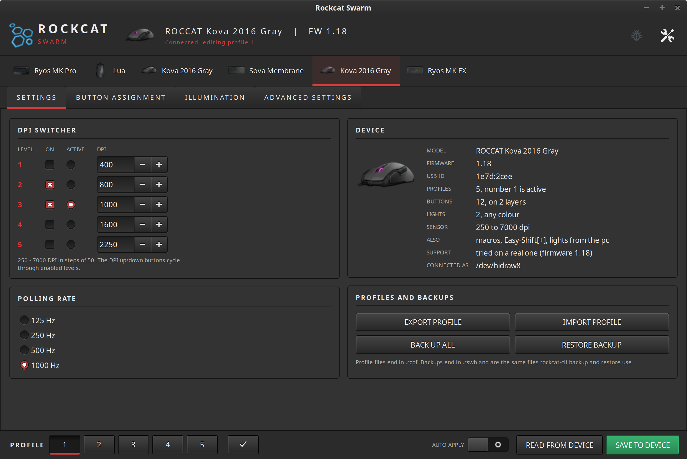

# rockcat-swarm

ROCCAT Swarm, but open source and on linux, because Turtle Beach kinda killed Swarm and you cant even download it anymore without extracting links from their CDN.

<p align="center"></p>



This is a fork of [rossat-swarm](https://github.com/TheElevatedOne/rossat-swarm) by TheElevatedOne, who reverse engineered Swarm 1.9482 to get his Kone AIMO Remastered working and then (fair enough) called it a day. The goal here is bigger: every device Swarm supported plus the older ones it never did, in a gui that doesnt make you want to throw the mouse.

It comes in three parts:

- `rockcat-swarm`, the GTK3 window. settings, button / key assignment, illumination, profiles, tray icon, one tab per plugged in device
- `rockcat-cli`, same thing for terminals and scripts
- `librockcat.so` + `include/rockcat/rockcat.h`, if you want to build your own thing in C or C++

<br>

> Note : on windows? you dont need this, the original Swarm and Ryos Software still work fine there. Installers and modules are archived at [512mb Archive/Software/Roccat](https://dsl.512mb.net/Software/Roccat/).

## What works

Short version: 56 devices, 5 of them tried on real hardware here so far. The full list is in [MODULES.md](MODULES.md), sorted into tested and working, assumed to work (siblings of tested ones), might work, basics might work and todo.

Tested on a real one:

- **ROCCAT Ryos MK FX** (`1e7d:2fda`): profiles, what every key does on all three layers (normal, Easy-Shift[+], Fn), macros, the colour of every key, effects, idle settings, lighting from the pc. In the gui: the keyboard to paint on, a key assignment page and macro recording. Effects the keyboard cant do are drawn by rockcat itself while the gui (or `rockcat-cli engine`) runs: wave, ripple, heatmap, an equalizer for what the computer plays, fire and drip, each with its own settings, plus idle and wake animations
- **ROCCAT Ryos MK Pro** (`1e7d:3232`): same keys and macros as the MK FX. Its keys are blue and only go on and off (no brightness per key, the hardware just cant), so the gui gives you LIGHT ON / LIGHT OFF instead of a colour picker. The engine effects work on it too, squashed into on and off
- **ROCCAT Kova 2016** gray (`1e7d:2cee`): profiles, dpi, polling, both lights, buttons with the Easy-Shift[+] layer, macros, lighting from the pc. Shown with ROCCATs picture of the mouse, a marker on every button and the lights in the colours you pick
- **ROCCAT Sova** membrane (`1e7d:2f76`): profiles, keys on all three layers, macros on the Easy-Shift keys, its effects, brightness and sleep timer. One backlight for the whole board, the picture shows what the effect does to it
- **ROCCAT Lua** (`1e7d:2c2e`): dpi steps, polling, buttons, left handed, the logo light. The Lua cant be asked anything back, so rockcat keeps what it last sent in its config dir. The settings get accepted by a real one, whether it really does all of it is still to be looked at


## Building

You need CMake 3.16 or newer, a C++17 compiler, `hidapi` 0.14 or newer (the hidraw backend), GTK 3, `libwebp` (the device pictures) and `glib-compile-resources`. `libayatana-appindicator3` is optional and gets you the tray icon.

Arch:

```bash
sudo pacman -S cmake hidapi gtk3 libwebp libayatana-appindicator
```

Debian and friends:

```bash
sudo apt install build-essential cmake pkg-config libhidapi-dev libgtk-3-dev libwebp-dev libayatana-appindicator3-dev
```

Gentoo or whatever you use: you know what to do.

Theres a Makefile so nobody has to remember the cmake incantations:

```bash
make
```

```bash
sudo make install
```

`make install` only installs what `make` built before, it doesnt build as root. `PREFIX=/usr` and `DESTDIR=...` work the way you expect, `make uninstall` takes it all out again and `make help` lists the rest.

The tests dont need a mouse:

```bash
make test
```

If you would rather talk to cmake yourself thats fine too, the Makefile doesnt do anything magic. The switches are `-DROCKCAT_BUILD_GUI=OFF`, `-DROCKCAT_BUILD_CLI=OFF` and `-DROCKCAT_BUILD_TESTS=OFF`.

### Packages

Installing through the package manager is nicer than `make install` because it can be removed cleanly again and the udev rule gets reloaded for you. Both of these drop the package into `dist/`.

Debian, Ubuntu and whatever else eats `.deb`:

```bash
make deb
```

```bash
sudo apt install ./dist/rockcat-swarm_*.deb
```

Arch (needs `makepkg`, which you have):

```bash
make arch
```

```bash
sudo pacman -U dist/rockcat-swarm-*.pkg.tar.zst
```

## Permissions

Before complaining that it cant find your mouse please read this section!

The devices are talked to through `/dev/hidraw*`, which normal users are not allowed to open. The udev rule fixes that. `cmake --install` puts it into `<prefix>/lib/udev/rules.d`, if you didnt install then copy it yourself:

```bash
sudo cp data/70-rockcat.rules /etc/udev/rules.d/
```

```bash
sudo udevadm control --reload
```

```bash
sudo udevadm trigger
```

If it still says no: UNPLUG THE MOUSE AND PLUG IT BACK IN. udev only hands out the new permissions when the device shows up again.

## CLI

```bash
rockcat-cli list                         # whats plugged in, with a number in front
rockcat-cli --device 2 info              # more than one device? pick it by that number (or by product id, 2e2c)
rockcat-cli info                         # firmware + active profile
rockcat-cli profile 2                    # switch to profile 2
rockcat-cli show -p 1                    # dump profile 1 settings
rockcat-cli set dpi1=800 dpi2=1600x1200 dpi-active=2 polling=1000
rockcat-cli set effect=fully-lit brightness=200 led=all:#65c3f7 led=wheel:#ff0000
rockcat-cli buttons                      # button assignment of the active profile
rockcat-cli bind 9 shortcut ctrl+c       # thumb backward -> Ctrl+C
rockcat-cli bind shift+11 volume-up
rockcat-cli bind 8 brightness-up         # thumb forward: brightness step up (engine)
rockcat-cli macro -b 8 --text "gg wp"    # store a text macro on thumb forward
rockcat-cli set effect=aimo theme=3      # AIMO uses theme colours, not per led colours
rockcat-cli set effect=breathing render=engine
rockcat-cli shift-light on '#ff0000' pulse  # Easy-Shift colour (engine rendered profiles)
rockcat-cli engine                       # draw AIMO / Heartbeat / *-2.0 effects (Ctrl+C stops)
rockcat-cli calibrate                    # TDCU calibration for your surface
rockcat-cli backup my.rswb               # all 5 profiles, `restore my.rswb` writes them back
rockcat-cli direct '#00ff00'             # host controlled colour, `direct off` to undo
rockcat-cli dump                         # raw hex of the reports
```

For devices that arent supported yet theres a raw mode that talks reports directly, and everything can be recorded:

```bash
rockcat-cli raw list                     # every ROCCAT hidraw node and the report ids it has
rockcat-cli --device /dev/hidraw4 raw get 0f 8   # read feature report 0f, 8 bytes
rockcat-cli capture mine.cap info        # run a command and write down everything that went over the wire
```

How recordings work and how to make one of YOUR device (please do, thats how devices get supported): [docs/CAPTURES.md](docs/CAPTURES.md).


## Lighting engine

The mouse firmware draws Off, Fully lit, Blinking, Breathing, Snake and Colorwave by itself. AIMO, Heartbeat, Breathing 2.0 and Heartbeat 2.0 are drawn BY THE PC (Swarm did the exact same thing), and so are profiles set to engine rendering, the Easy-Shift[+] lighting and the brightness buttons. Meaning: if nothing on the pc is running, those effects are just dark. One of these has to be up:

- `rockcat-swarm`, window or tray
- `rockcat-cli engine` in a terminal
- the user service, if you want it always on without the gui:

```bash
systemctl --user enable --now rockcat-engine.service
```

Only one engine runs at a time, the gui tells you when the service already has it. The engine follows the active profile so switching profiles on the mouse switches the effect too, and it hands the leds back to the firmware when it stops.


## Known meh

- most devices are untested (see [MODULES.md](MODULES.md)). They are written from roccat-tools or from the Swarm modules and run fine against their pretend selves, which only proves I understood the documents the way I think. Own one of them? Back it up first (`rockcat-cli --device PID backup my.rswb`, that only reads), then try. A recording of it (`rockcat-cli capture mine.cap backup x.rswb`, read only too) is the best thing you can send in, see [docs/CAPTURES.md](docs/CAPTURES.md)
- nobody working on this fork owns a Kone AIMO Remastered, the one device upstream supported. Changes to its code are guarded by the offline tests and a recording made against a simulated mouse, not a real one. If you own one: a real recording would be very prem
- light from the pc (the engine effects) is only done for the Kone AIMO and AIMO Remastered, the Kone[+] / XTD / Pure family, the Kova 2016, the Ryos MK FX, MK Pro and TKL Pro. the others only show what they store themselves
- the Nyth picture probably has its button markers on the wrong buttons, Swarm counts them differently than roccat-tools and I follow roccat-tools
- firmware updates are not implemented.
- the AIMO animation is my own take on Swarms (same themes, led groups and activity reaction), not a byte exact copy of `aimo.dll`.
- This repo and the resulting executable is very very fat (I love bundeling PNGs ...)
    - Atleast now I understand why Roccat distributed everything as a module in Swarm

## Credits and legal stuff

- [TheElevatedOne](https://github.com/TheElevatedOne/rossat-swarm) wrote rossat-swarm, which this is forked from. The whole Kone AIMO Remastered protocol work is his.
- Not affiliated with ROCCAT or Turtle Beach in any way. No ROCCAT code is in here, the Swarm layout is rebuilt in GTK and the app icon is an original drawing.
- The device pictures in `assets/roccat/` ARE ROCCATs, taken from Swarm, and they are not under the GPL like the rest. Where each one came from and how to build without them (`-DROCKCAT_ROCCAT_ASSETS=OFF`) is in [assets/roccat/ATTRIBUTION.md](assets/roccat/ATTRIBUTION.md). Rights holder and unhappy about it? Open an issue, they get removed.
- License: [GPL-3.0-only](LICENSE) for everything except `assets/roccat/`.

## Whats where

```
include/rockcat/rockcat.h   public C API
src/lib/                    protocol + HID transport (hidapi)
src/cli/                    rockcat-cli
src/gui/                    rockcat-swarm (GTK3)
data/                       icon, css, udev rule, desktop file, user service, pkg-config template
assets/roccat/              device pictures out of Swarm, not ours, read the ATTRIBUTION.md in there
assets/free/                my own stand ins with the same names, for builds without the above
tools/dev/                  gui-shot.sh, takes a picture of the gui without a screen
tools/assets/               the scripts that fill those two folders (extract.py for icons, mouse-view.py for the mouse pictures with markers and lights), plus dump-swarm.sh and sort-swarm.py if you want ALL the artwork out of your own Swarm install, sorted per device
docs/protocol/              what I know about how the devices talk, one file per family (README.md in there is the part all of them share)
docs/CAPTURES.md            how recordings work
tools/re/                   scripts used for the reverse engineering
tools/capture/              read only scripts that record what a device has stored
tests/                      offline tests (no device needed)
tests/captures/             the recordings the tests replay
aur/                        PKGBUILDs
.github/workflows/          build + test and a .deb on every push, release tarball per tag
Makefile                    make, make test, make install, make deb, make arch
packaging/                  what make deb and make arch need (postinst, PKGBUILD template)
MODULES.md                  every Swarm device module plus the older devices, what works and what was tested
icon.svg                    icon source drawing (data/rockcat-swarm.svg adds the accent colours)
```
