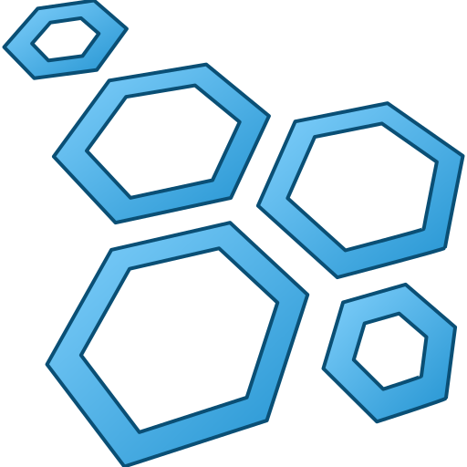

# rockcat-swarm

ROCCAT Swarm, but open source and on linux, because Turtle Beach took Swarm behind the shed and you cant even download it anymore.

<p align="center"></p>

This is a fork of [rossat-swarm](https://github.com/TheElevatedOne/rossat-swarm) by TheElevatedOne, who reverse engineered Swarm 1.9482 to get his Kone AIMO Remastered working and then (fair enough) called it a day. The goal here is bigger: every device Swarm supported plus the older ones it never did, in a gui that doesnt make you want to throw the mouse.

It comes in three parts:

- `rockcat-swarm`, the GTK3 window. settings, button assignment, illumination, 5 profiles, tray icon
- `rockcat-cli`, same thing for terminals and scripts
- `librockcat.so` + `include/rockcat/rockcat.h`, if you want to build your own thing in C or C++

<br>

> Note : on windows? you dont need this, the original Swarm and Ryos Software still work fine there. Installers and modules are archived at [512mb Archive/Software/Roccat](https://dsl.512mb.net/Software/Roccat/).

## What works

Right now exactly one device, the same one upstream supported:

- **ROCCAT Kone AIMO Remastered** (`1e7d:2e2c`)

Next up are the Kova 2016 and the Ryos MK FX, simply because those two are plugged into the machine this gets written on. After that the rest of the Ryos family, Sova, Lua and then whatever we can dig out of roccat-tools and the Swarm modules. [MODULES.md](MODULES.md) has every device module Swarm could download, the ticked ones work here.

What the Kone AIMO Remastered can do with it:

- read and switch the active profile (5 on board)
- dpi switcher: 5 levels, 100 to 16000 in steps of 50, seperate X/Y, enable mask, active level
- polling rate 125/250/500/1000 Hz, angle snapping, debounce time
- button assignment for all 12 buttons plus the Easy-Shift[+] layer, with shortcuts, text macros and brightness up/down buttons
- lighting: effect, speed, brightness, colour and on/off for each of the 11 leds, AIMO colour themes
- a lighting engine for the effects the firmware cant draw by itself (AIMO, Heartbeat, Breathing 2.0, Heartbeat 2.0), reacts to mouse activity like Swarm did
- your own Easy-Shift[+] colour while the button is held. the mouse has its light blue hard coded in the firmware so we draw it from the pc instead
- any effect can be drawn by the engine, which also gets you an actual white (the firmware white looks mint because of the amber leds, ewww)
- sensor (TDCU) calibration for your mousepad
- backup and restore of all five profiles
- raw report access for everything that isnt decoded yet

Protocol writeup: [docs/PROTOCOL.md](docs/PROTOCOL.md).

## Building

You need CMake 3.16 or newer, a C++17 compiler, `hidapi` 0.14 or newer (the hidraw backend), GTK 3 and `glib-compile-resources`. `libayatana-appindicator3` is optional and gets you the tray icon.

Arch:

```bash
sudo pacman -S cmake hidapi gtk3 libayatana-appindicator
```

Debian and friends:

```bash
sudo apt install build-essential cmake pkg-config libhidapi-dev libgtk-3-dev libayatana-appindicator3-dev
```

Gentoo or whatever you use: you know what to do.

Theres a Makefile so nobody has to remember the cmake incantations:

```bash
make
```

```bash
sudo make install
```

`make install` only installs what `make` built before, it doesnt build as root. `PREFIX=/usr` and `DESTDIR=...` work the way you expect, `make uninstall` takes it all out again and `make help` lists the rest.

The tests dont need a mouse:

```bash
make test
```

If you would rather talk to cmake yourself thats fine too, the Makefile doesnt do anything magic. The switches are `-DROCKCAT_BUILD_GUI=OFF`, `-DROCKCAT_BUILD_CLI=OFF` and `-DROCKCAT_BUILD_TESTS=OFF`.

### Packages

Installing through the package manager is nicer than `make install` because it can be removed cleanly again and the udev rule gets reloaded for you. Both of these drop the package into `dist/`.

Debian, Ubuntu and whatever else eats `.deb`:

```bash
make deb
```

```bash
sudo apt install ./dist/rockcat-swarm_*.deb
```

Arch (needs `makepkg`, which you have):

```bash
make arch
```

```bash
sudo pacman -U dist/rockcat-swarm-*.pkg.tar.zst
```

> Note : every push also builds the `.deb` on github, its attached to the workflow run under Actions and to the release when a version gets tagged. Handy if you dont feel like compiling.

> Note : `make arch` also runs on debian if `makepkg` and `libarchive-tools` are installed, thats how the package gets test built here. Wether a package built that way behaves on a real arch box is untested, build it on arch if you can.

There are also PKGBUILDs for the AUR in [`aur/`](aur) but they are not published, see [Known meh](#known-meh).

## Permissions

Before complaining that it cant find your mouse please read this section!

The devices are talked to through `/dev/hidraw*`, which normal users are not allowed to open. The udev rule fixes that. `cmake --install` puts it into `<prefix>/lib/udev/rules.d`, if you didnt install then copy it yourself:

```bash
sudo cp data/70-rockcat.rules /etc/udev/rules.d/
```

```bash
sudo udevadm control --reload
```

```bash
sudo udevadm trigger
```

If it still says no: UNPLUG THE MOUSE AND PLUG IT BACK IN. udev only hands out the new permissions when the device shows up again.

## CLI

```bash
rockcat-cli list                         # find the mouse
rockcat-cli info                         # firmware + active profile
rockcat-cli profile 2                    # switch to profile 2
rockcat-cli show -p 1                    # dump profile 1 settings
rockcat-cli set dpi1=800 dpi2=1600x1200 dpi-active=2 polling=1000
rockcat-cli set effect=fully-lit brightness=200 led=all:#65c3f7 led=wheel:#ff0000
rockcat-cli buttons                      # button assignment of the active profile
rockcat-cli bind 9 shortcut ctrl+c       # thumb backward -> Ctrl+C
rockcat-cli bind shift+11 volume-up
rockcat-cli bind 8 brightness-up         # thumb forward: brightness step up (engine)
rockcat-cli macro -b 8 --text "gg wp"    # store a text macro on thumb forward
rockcat-cli set effect=aimo theme=3      # AIMO uses theme colours, not per led colours
rockcat-cli set effect=breathing render=engine
rockcat-cli shift-light on '#ff0000' pulse  # Easy-Shift colour (engine rendered profiles)
rockcat-cli engine                       # draw AIMO / Heartbeat / *-2.0 effects (Ctrl+C stops)
rockcat-cli calibrate                    # TDCU calibration for your surface
rockcat-cli backup my.rswb               # all 5 profiles, `restore my.rswb` writes them back
rockcat-cli direct '#00ff00'             # host controlled colour, `direct off` to undo
rockcat-cli dump                         # raw hex of the reports
```

For devices that arent supported yet theres a raw mode that talks reports directly, and everything can be recorded:

```bash
rockcat-cli raw list                     # every ROCCAT hidraw node and the report ids it has
rockcat-cli --device /dev/hidraw4 raw get 0f 8   # read feature report 0f, 8 bytes
rockcat-cli capture mine.cap info        # run a command and write down everything that went over the wire
```

No mouse on the desk? `ROCKCAT_SIM=kone-aimo-remastered` in front of any command (the gui too) gives you a simulated one to play with. It answers like the real thing as far as we know and forgets everything when the program exits.

How recordings work and how to make one of YOUR device (please do, thats how devices get supported): [docs/CAPTURES.md](docs/CAPTURES.md).

`rockcat-cli --help` lists every key, `rockcat-cli types` lists the button functions. Profiles, dpi levels, buttons and leds count from 1 on the command line, like normal people count.

## GUI and tray

`rockcat-swarm` opens the Swarm style window, coloured by whatever GTK theme you run. Button Assignment takes shortcuts as text (`ctrl+c`, `alt+f4`) and text macros. Illumination has the effect list, the "render with the engine" option, AIMO themes and the Easy-Shift[+] lighting. Advanced Settings has angle snapping, debounce, sensor calibration and the raw settings report for the brave.

The footer picks the profile you are editing (the `*` marks the one thats active on the mouse), **ACTIVATE** makes it the active one and the **AUTO APPLY** switch writes every change straight to the mouse instead of waiting for **APPLY**.

Under Settings -> Application:

- **Keep running in the system tray**: closing the window hides it to the tray instead of quitting. Needs something that speaks StatusNotifierItem (waybar, KDE, GNOME with the AppIndicator extension because of course gnome needs an extension for that).
- **Start minimized to the tray**: only there when the tray is on.

`rockcat-swarm --minimized` (or `-m`) starts hidden in the tray for that one run, thats the one you want in your autostart. On Hyprland for example:

```
exec-once = rockcat-swarm --minimized
```

The gui keeps its own preferences in `~/.config/rockcat/gui.ini`.

> Note : coming from rossat-swarm? `~/.config/rossat` gets moved to `~/.config/rockcat` on the first start, nothing to do by hand.

## Lighting engine

The mouse firmware draws Off, Fully lit, Blinking, Breathing, Snake and Colorwave by itself. AIMO, Heartbeat, Breathing 2.0 and Heartbeat 2.0 are drawn BY THE PC (Swarm did the exact same thing), and so are profiles set to engine rendering, the Easy-Shift[+] lighting and the brightness buttons. Meaning: if nothing on the pc is running, those effects are just dark. One of these has to be up:

- `rockcat-swarm`, window or tray
- `rockcat-cli engine` in a terminal
- the user service, if you want it always on without the gui:

```bash
systemctl --user enable --now rockcat-engine.service
```

Only one engine runs at a time, the gui tells you when the service already has it. The engine follows the active profile so switching profiles on the mouse switches the effect too, and it hands the leds back to the firmware when it stops.

## Library

```c
#include <rockcat/rockcat.h>

rockcat_device *dev;
if (rockcat_open(NULL, &dev) == ROCKCAT_OK) {
    const rockcat_caps *caps = rockcat_get_caps(dev);   /* how many leds, buttons, dpi levels this thing has */
    rockcat_profile *p;
    if (rockcat_profile_read(dev, 0, &p) == ROCKCAT_OK) {
        rockcat_profile_set_dpi(p, 0, 1200, 1200, 1);
        for (int led = 0; led < caps->led_count; ++led)
            rockcat_profile_set_led(p, led, (rockcat_color){255, 255, 0, 0}, 1);
        rockcat_profile_write(dev, p);                  /* only sends what changed, unknown bytes are preserved */
        rockcat_profile_free(p);
    }
    rockcat_close(dev);
}
rockcat_exit();
```

Link it with `pkg-config --cflags --libs rockcat`, or from CMake with `find_package(rockcat)` and `target_link_libraries(app rockcat::rockcat)`. Every call returns `ROCKCAT_OK` or a negative `rockcat_error`, `rockcat_strerror()` turns that into text.

> Note : if you built something against rossat-swarm: the structs with 11 leds and 24 buttons baked in are gone from the header, on purpose. The profile api above works the same for every device, a keyboard just answers `ROCKCAT_ERR_UNSUPPORTED` when you ask it for a dpi.

## Known meh

- one supported device. working on it.
- nobody working on this fork owns a Kone AIMO Remastered, allbeit its the only device that works rn (yes, really). Changes to its code are guarded by the offline tests and a recording made against a simulated mouse, not a real one. If you own one: a real recording would be very prem, see [docs/CAPTURES.md](docs/CAPTURES.md). And if something broke, please open an issue.
- not on the AUR. The PKGBUILDs in `aur/` are there but not pushed, nobody here has an arch machine to test them on. Use `make arch` on your own box instead. The old `rossat-swarm-bin` / `rossat-swarm-git` AUR packages are upstreams and still install the old thing.
- firmware updates are not implemented.
- the AIMO animation is our own take on Swarms (same themes, led groups and activity reaction), not a byte exact copy of `aimo.dll`.
- Swarms "sensitivity" slider was the windows pointer speed and not a mouse setting, so its not here. Your desktop has a slider for that.
- writes always start from the bytes last read from the mouse so fields we dont understand go back unchanged. Thats on purpose, not meh, but good to know.

## Credits and legal stuff

- [TheElevatedOne](https://github.com/TheElevatedOne/rossat-swarm) wrote rossat-swarm, which this is forked from. The whole Kone AIMO Remastered protocol work is his.
- Not affiliated with ROCCAT or Turtle Beach in any way. No ROCCAT code or artwork is in here, the Swarm layout is rebuilt in GTK and the icon is an original drawing.
- License: [GPL-3.0-only](LICENSE).

## Whats where

```
include/rockcat/rockcat.h   public C API
src/lib/                    protocol + HID transport (hidapi)
src/cli/                    rockcat-cli
src/gui/                    rockcat-swarm (GTK3)
data/                       icon, css, udev rule, desktop file, user service, pkg-config template
docs/PROTOCOL.md            reverse engineered protocol and firmware notes
docs/CAPTURES.md            how recordings work
tools/re/                   scripts used for the reverse engineering
tools/capture/              read only scripts that record what a device has stored
tests/                      offline tests (no device needed)
tests/captures/             the recordings the tests replay
aur/                        PKGBUILDs
.github/workflows/          build + test and a .deb on every push, release tarball per tag
Makefile                    make, make test, make install, make deb, make arch
packaging/                  what make deb and make arch need (postinst, PKGBUILD template)
MODULES.md                  all Swarm device modules, with support checkboxes
icon.svg                    icon source drawing (data/rockcat-swarm.svg adds the accent colours)
```
